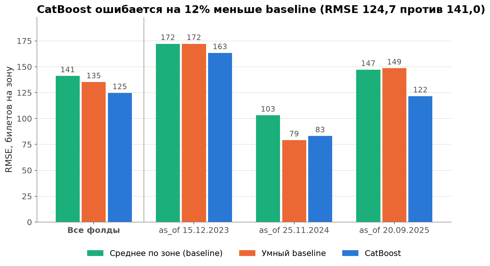
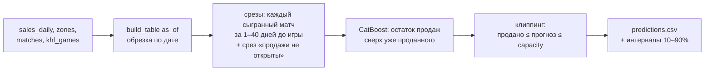
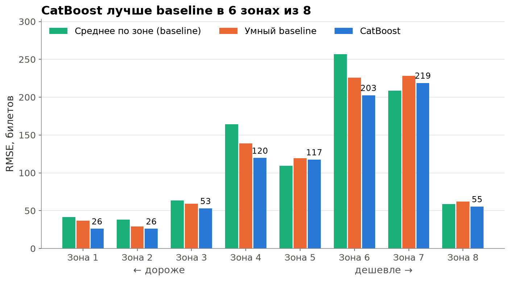
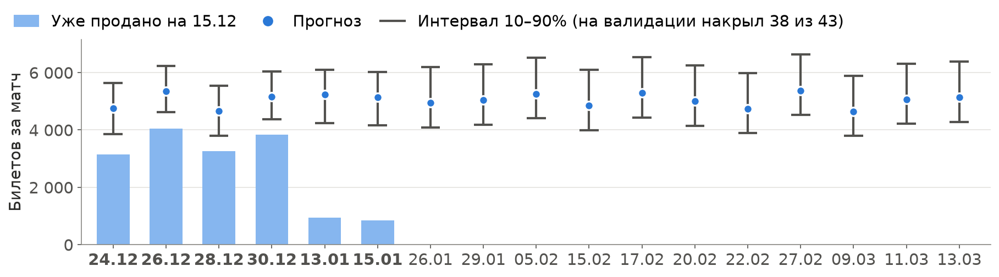

<div align="center">

# 🏒 Прогноз продаж билетов ХК «Авангард»

**Сколько билетов продастся на каждый оставшийся матч сезона 2025/26 в каждой ценовой зоне?**


Хакатон **DataMatch** · технический трек

</div>

---

## Коротко

Нужно спрогнозировать `tickets_total`, то есть сколько **разовых** билетов продастся за всё время продаж, для **17 матчей** (M086–M102) в **8 ценовых зонах**. Всего 136 прогнозов, метрика — RMSE. Дата отсечки данных — 15.12.2025, шесть матчей к этому дню уже в продаже.

| Модель | RMSE, билетов на зону |
|---|---:|
| Baseline из задания: среднее по зоне | 141,0 |
| Умный baseline: среднее по зоне за сезон, не ниже уже проданного | 135,2 |
| **CatBoost на срезах продаж (итог)** | **124,7** |

Ошибка меньше на 12% против baseline из задания. Значимость проверена бутстрэпом по матчам (2 000 повторов): против baseline из задания выигрыш −16,4, 95% интервал [−25,5; −7,2]. Против умного baseline выигрыш −10,5, интервал [−20,4; −0,1], это на грани значимости, и README этого не скрывает.



## Что внутри решения



- **Без утечек.** Все данные берутся через `src/data.py`: остаются только строки раньше `as_of`. Для `as_of` позже 15.12.2025 код падает с ошибкой. Утечку проверяет отдельный тест: он портит данные после `as_of` и убеждается, что признаки и прогнозы не меняются.
- **Валидация «псевдо-сегодня».** Три фолда: 15.12.2023, 25.11.2024 и 20.09.2025. Модель учится на матчах, сыгранных до этой даты, и прогнозирует следующие, ровно как в задаче. Случайный сплит не используется: он пускает в обучение будущее.
- **Срезы продаж.** На дату прогноза часть матчей уже в продаже, часть нет. Поэтому каждый сыгранный матч превращается в несколько «снимков» состояния продаж, и модель учится на обоих случаях.
- **Две модели остатка.** Для матчей в продаже остаток считается в долях свободных мест (учитывает потолок зоны), для ещё не открытых — в долях уровня зоны (переносится между сезонами).
- **Признаки:** продажи на дату и их темп, уровень зоны, календарь, история соперника, сила соперника и форма «Авангарда» из КХЛ.
- **Детерминизм.** `random_state=42`, версии библиотек закреплены, обучение не зависит от числа ядер. `predictions.csv` воспроизводится побайтово.

## Где модель ошибается



Основная ошибка — в массовых зонах **6 и 7** (RMSE 202,6 и 218,8 против 26–56 в зонах 1–3 и 8): спрос между ними переключается от матча к матчу, а цен и схемы зала в данных нет. На матчах, где продажи уже идут, ошибка заметно ниже (106 против 132 билетов), поэтому прогноз имеет смысл обновлять каждую неделю по свежим продажам.

## Прогноз с интервалами

Рядом с точечным прогнозом лежат интервалы 10–90% по строкам и по матчам. По матчам на валидации они накрыли 38 из 43 игр (88%).



На 17 оставшихся матчей прогноз — 85 631 билет, в среднем 5,0 тыс. за матч.

## Быстрый старт

Нужен Python 3.12. Данные хакатона в репозиторий не входят: положи файлы организаторов в `data/` (список в `data/README.txt`). Все команды выполняются из корня репозитория.

```bash
python -m venv .venv
# Windows:
.venv\Scripts\activate
# Linux/Mac:
source .venv/bin/activate

pip install -r requirements.txt
python -m jupyter nbconvert --to notebook --execute notebooks/solution.ipynb
```

Ноутбук за 30–40 секунд сохраняет `predictions.csv` в корень. Выполненную копию nbconvert кладёт в `notebooks/solution.nbconvert.ipynb`.

> Сначала активируйте venv: иначе `jupyter` может подхватить глобальный Python с другими версиями библиотек, и результат не совпадёт.

Проверки:

```bash
python -m src.data             # сборка таблицы match_id × zone и обрезка по дате
python -m tests.test_leakage   # будущее после as_of не доходит до модели
python -m tests.test_model     # срезы = build_table, прогноз не зависит от числа ядер и совпадает с predictions.csv
```

## Структура

```
src/
  data.py        load_raw, build_table(as_of), load_daily_sales, load_khl: вся обрезка по дате здесь
  validation.py  фолды «псевдо-сегодня», evaluate(predict_fn), predict_test(predict_fn)
  baseline.py    среднее по зоне и умный baseline
  model.py       CatBoost на срезах продаж
notebooks/
  01_eda.ipynb       разведочный анализ
  02_baseline.ipynb  схема валидации и baseline'ы
  03_model.ipynb     признаки, абляции, разбор ошибок, новогодние матчи
  04_report.ipynb    проверка прогноза, значимость, графики для презентации
  solution.ipynb     финальный: с нуля выдаёт predictions.csv
tests/           тест утечки и тест замороженной модели
reports/         презентация (PDF), графики, заметки о воспроизводимости
submissions/     прогнозы моделей и интервалы
predictions.csv  итоговый прогноз, 136 строк
```

## Допущения

- Дата отсечки — 15.12.2025. Продажи в данных есть до 14.12.2025 включительно.
- `seats`, `season_tickets` и `sales_open` считаются известными заранее для всех матчей и по дате не обрезаются.
- Результаты КХЛ в данных заканчиваются 19.11.2025, поэтому позже соперников и форму «Авангарда» модель не видит.
- `season_tickets_daily.csv` не используется: места под абонементами берутся из `zones.csv`.
- Внешние данные не применялись, код читает только файлы из `data/`.

## Ограничения

- **Выигрыш над умным baseline на грани значимости.** Модель разрабатывалась на тех же трёх фолдах, на которых оценивается, поэтому 124,7 скорее оптимистичная оценка.
- **Новогодние матчи (26–30.12).** К 15.12 на них уже продано 51–59% мест. Прошлые Новые годы раскупались так же рано, но итог в них не вырастал. Модель даёт 73–77% заполнения, аналогия с прошлыми Новыми годами — 56–63%: риск в обе стороны, скорее в сторону переоценки. Подробный разбор в `notebooks/03_model.ipynb`.
- **Зоны 6 и 7** остаются главным источником ошибки.

## Команда

| | Участник | Вклад |
|---|---|---|
| 🛠 | **augustteske** | данные, валидация, baseline, финальный ноутбук, отчёт |
| 🧠 | **sharbl4 (Антон)** | модель CatBoost, признаки, тесты |
| 🔍 | **ArinaPig (Арина)** | разведочный анализ |
| 🎤 | **Алиса** | презентация |

Подробности про воспроизводимость и хэши `predictions.csv` — в [`reports/reproducibility.md`](reports/reproducibility.md).
